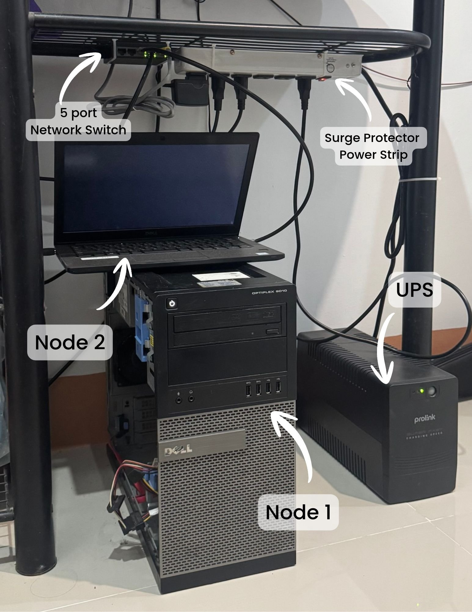
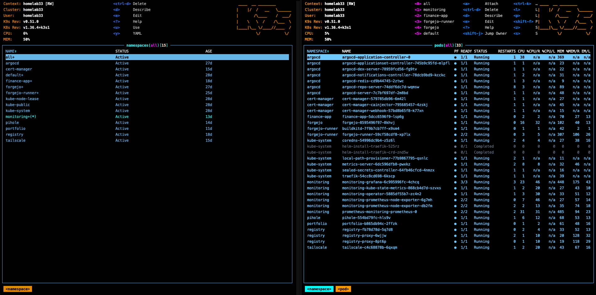
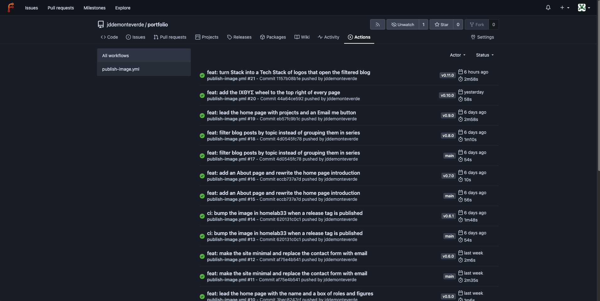
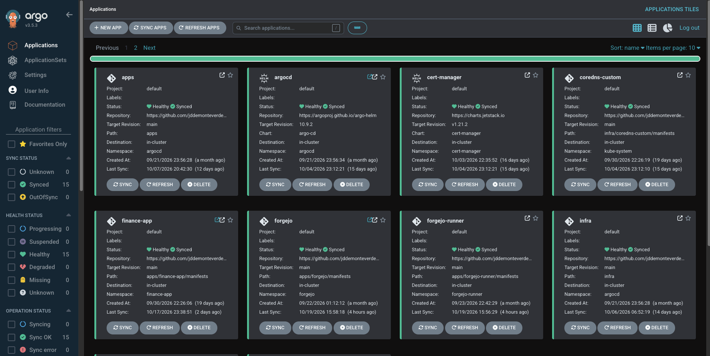

# homelab33

A GitOps-managed Kubernetes cluster on two recycled machines. It runs my own Git, CI, image
registry and apps. Only my portfolio is open to the internet, through a Cloudflare Tunnel.

This is my homelab. It runs on an old desktop PC and an old laptop at home, using
[k3s](https://k3s.io), a lightweight, certified Kubernetes distribution.

This repository is the setup of the whole cluster. I don't log into the servers to install or
change things. I change the files here and push to `main` on my Forgejo, which mirrors it to
GitHub, and [Argo CD](https://argo-cd.readthedocs.io) updates the cluster to match. This way of
working is called GitOps.

## Highlights

- **A tag is all I push to ship an app.** CI builds the image on rootless BuildKit, commits the new
  tag here, and Argo CD rolls it out. [How a change goes live](#4-how-a-change-goes-live)
- **No port is open on my router.** Apps are reachable only from my tailnet, through an
  unprivileged Tailscale proxy, and served with a real wildcard certificate. The one public site,
  my portfolio, goes out through a Cloudflare Tunnel that can reach nothing else.
  [infra](infra/) · [Portfolio](apps/portfolio/)
- **CI can't take over the cluster.** Jobs get no Docker socket, run only on the laptop, and can
  reach only what they need. Everything that can read secrets runs on the other machine.
  [Forgejo runner](apps/forgejo-runner/)
- **Nodes pull my private images with no node config.** A proxy on `localhost` gets around
  containerd's HTTPS rule. [Container registry](apps/registry/)
- **Every commit is checked.** CI builds and schema-validates every manifest, rejects plaintext
  secrets and unpinned images, and scans the history for leaked credentials.
  [CI](.forgejo/)
- **AI agents work here under written rules.** [AGENTS.md](AGENTS.md) tells them what they may
  change, what they must never commit, and that only git changes the cluster.

The bugs and choices behind these are in [Decisions and lessons](docs/decisions.md).

Let me walk you through it.

## 1. The machines

| Machine | What it does |
| --- | --- |
| Old desktop PC | Runs the parts that manage the cluster, Forgejo, my finance app, and the DNS for my home network |
| Old laptop | Runs my public site and my CI builds |

Both were sitting unused before this. Now they run all the time.

| | Desktop | Laptop |
| --- | --- | --- |
| Model | Dell OptiPlex 9010 | Dell Latitude 7290 |
| Role | k3s server (control plane) | k3s agent (worker) |
| CPU | 4 threads | 4 threads |
| Memory | 8 GB | 8 GB |
| Disk | 250 GB | 250 GB |
| OS | Ubuntu 22.04 LTS | Ubuntu 22.04 LTS |
| k3s | v1.36.4 | v1.36.4 |



The desktop is node 1 and the laptop, sitting on top of it, is node 2. A 5-port switch connects
them, and a UPS sits next to them.

## 2. How I reach my apps

My apps are only reachable through my [Tailscale](https://tailscale.com) network (a tailnet), a
private network made up of my own devices. So I can open them from my phone or laptop wherever I
am, but nobody else can.

The exception is my portfolio, which is meant to be public. A
[Cloudflare Tunnel](https://developers.cloudflare.com/cloudflare-one/connections/connect-networks/)
in its namespace connects out to Cloudflare and hands visitors' requests to the site, so I don't
open any port at home. The tunnel can reach the portfolio and nothing else.
[How it's locked down](apps/portfolio/)

## 3. What's running

| App | What it's for | Read more |
| --- | --- | --- |
| Forgejo | My own Git platform, like GitHub | [apps/forgejo](apps/forgejo/) |
| Forgejo runner | Runs my CI pipelines and builds Docker images | [apps/forgejo-runner](apps/forgejo-runner/) |
| Container registry | Stores the images my CI builds | [apps/registry](apps/registry/) |
| Finance app | A personal finance app I made | [apps/finance-app](apps/finance-app/) |
| Portfolio | My portfolio site and blog | [apps/portfolio](apps/portfolio/) |
| Pi-hole | Blocks ads for every device at home | [apps/pihole](apps/pihole/) |
| Monitoring | Lets me check on my servers when I'm away | [infra/monitoring](infra/monitoring/) |

Here it all is in [k9s](https://k9scli.io), every namespace and pod:



If you want to follow along, start with [Forgejo](apps/forgejo/). Each page links to the next one
at the bottom.

## 4. How a change goes live

Shipping a new version of one of my apps starts with one step from me.

First, I push a version tag to the app's repository on Forgejo. Forgejo runs the CI pipeline,
which builds the Docker image and stores it in my own registry, all inside the cluster.



In Forgejo Actions, each push to `main` and each version tag is a run:



Then the new image tag is committed to this repository. The pipeline does that itself once the
image is in the registry, so the tag is all I push. Forgejo mirrors this repository to GitHub,
Argo CD picks up the change from there and updates the cluster, and the new pod pulls the image
from the registry.



Argo CD shows every app healthy and synced to `main`:



## 5. How the repository is laid out

```text
bootstrap/   Two starting Argo CD apps. I applied these once by hand; they pull in everything else
infra/       What keeps the cluster running: Argo CD, certificates, Tailscale, DNS, monitoring
apps/        My apps, one folder each
```

If you want to see how the pieces connect, [infra/](infra/) explains it.

## 6. A few things I made sure of

- Every app is served over HTTPS with one wildcard Let's Encrypt certificate. cert-manager renews
  it by itself with a DNS-01 challenge, so nothing has to be open to the internet.
- Passwords and keys are stored here only in encrypted form (Sealed Secrets), so this repo can
  be public.
- Apps run without root where they can, and each namespace has a NetworkPolicy that only lets in
  the connections it needs.
- Every image and chart version is pinned, so nothing changes unless I change it here.
- CI checks every commit to `main`. [What it checks](.forgejo/)

## 7. What's not done yet

- **One control-plane node.** If the desktop is down, the cluster can't be managed, and my home
  network loses its DNS.
- **No automated backups.** Volumes live on each machine's own disk. For now, backups are taken
  by hand, as described in [Disaster recovery](docs/disaster-recovery.md).
- **One privileged container.** CI's Docker-in-Docker sidecar needs `privileged`.
  [How it's fenced in](apps/forgejo-runner/#the-one-privileged-container)
- **No login on the registry or Prometheus.** NetworkPolicies decide who can reach them.
- **Alerts go nowhere.** The default alert rules run, but nothing sends them to me yet.
- **CI flags a bad commit but doesn't block it.** Image bumps from CI go straight to `main`.

## 8. More to read

- [Decisions and lessons](docs/decisions.md): why things are the way they are
- [Disaster recovery](docs/disaster-recovery.md): what holds state and how to rebuild
- [AGENTS.md](AGENTS.md): the full conventions, written for AI agents but useful for anyone
