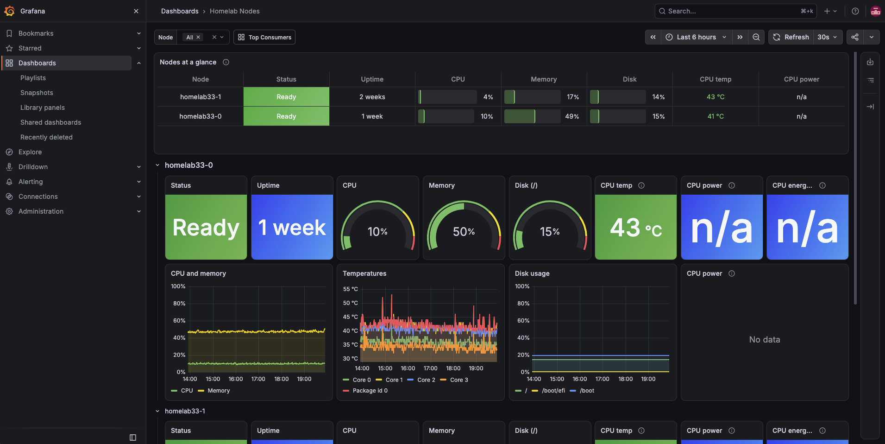
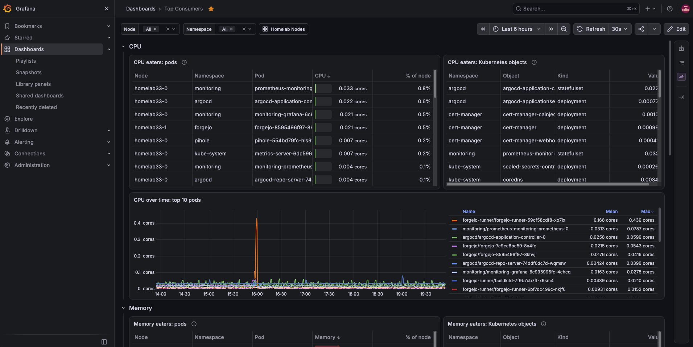

# Monitoring

This is so I can monitor my servers even when I'm away. Grafana is on my tailnet, so I can open
it from my phone and see how the machines are doing and what's using them.

## Dashboards

| Dashboard | What it shows |
| --- | --- |
| Homelab Nodes | Each machine's uptime, CPU, memory, disk, CPU temperature, and CPU power and energy over the last 24 hours |
| Top Consumers | Which pods and apps use the most CPU, memory and disk |

The two dashboards link to each other. They're saved as JSON files in `manifests/dashboards/`.
Grafana can't save changes to them, so I edit them through git.

## How it's set up

It's the [kube-prometheus-stack](https://github.com/prometheus-community/helm-charts/tree/main/charts/kube-prometheus-stack)
Helm chart, pinned, installed by Argo CD with `values.yaml` from this folder.

| Part | What it does |
| --- | --- |
| Prometheus | Collects the numbers. Keeps 30 days or 15 GB, whichever comes first, on a 20 Gi volume |
| Grafana | Shows the dashboards, over HTTPS, tailnet only. Admin password is a Sealed Secret |
| node-exporter | Runs on each machine and reports its hardware stats |
| kube-state-metrics | Reports the state of Kubernetes objects |

Alertmanager is off. The chart's default alert rules still run, so firing alerts show in
Prometheus and Grafana, but nothing sends them anywhere yet.

- Prometheus has no login, so it has no Ingress. Only Grafana talks to it, inside the cluster.
- node-exporter uses the host network so it can see the machine's real network interfaces. It
  listens on `127.0.0.1` behind kube-rbac-proxy, which only answers requests with a token that
  Kubernetes allows.
- Everything except node-exporter runs on the desktop, because the operator can read every
  secret.

## Adding more

- To collect metrics from an app, add a `ServiceMonitor` or `PodMonitor` to its manifests, and let
  the `monitoring` namespace reach its metrics port in its NetworkPolicy.
- To add a dashboard, export it from Grafana with "Export for sharing externally" off, save it in
  `manifests/dashboards/`, and add it to the `configMapGenerator` in that folder.

---

Next: [infra](../), the parts that keep the cluster running. · [Back to the start](../../)
